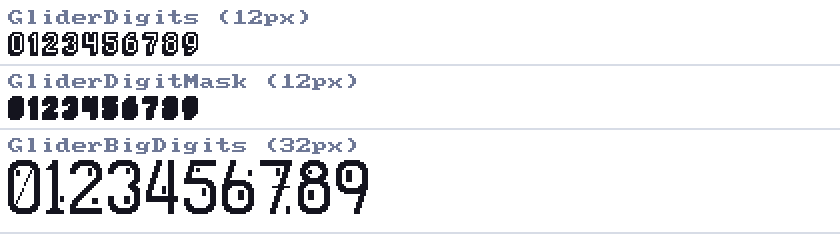

# Glider 4



| | |
|---|---|
| Platform | Macintosh, 1991 (game) |
| Author | John Calhoun (softdorothy) |
| Licence | **MIT** (see [LICENSE](LICENSE)) |
| Confidence | High |
| Source | https://github.com/softdorothy/Glider4 (`Glider_405/Glider.r`) |

**Why it is here.** The author published the full game, including its resource file, under MIT. These are the game's own custom numerals.

**Notes**

- `Glider.r` also carries FONT 2060 / FOND 16, which is Apple's Palatino. It is **not** included: the author could not license it.

**Converted files**

- These are **not period files**: the software never shipped a Windows `.FON` or `.FNT`. They were made for this repo from `original/`.
- Glyph shapes are unchanged. Any kerning is dropped, and empty code positions show a substitute character.
- The names "GliderDigits", "GliderDigitMask" and "GliderBigDigits" were made up for this repo; the originals are unnamed. The copyright text in the font header was filled in here too.

**Original files.** The `.bin` files are the bare contents of the Mac `FONT`/`NFNT` resources, extracted unchanged but without the resource file or `FOND` around them. The file names are ours.

## Original files (SHA-256)

```
61f0fc7a5e6a43c20a94b1e101883b511826eb15942a64de7bc19ccd9002789a  GLIDDIG.FONT-25612.bin
b918e612c5d41446733e8f8c67e537d2561c546138a1147c8e2248c72aab6c68  GLIDMSK.FONT-25740.bin
9bf12c2a6f41692846970b7b103c9263b4caffbcf572419d20ceb2ea14bec07e  GLIDBIG.FONT-26144.bin
```
