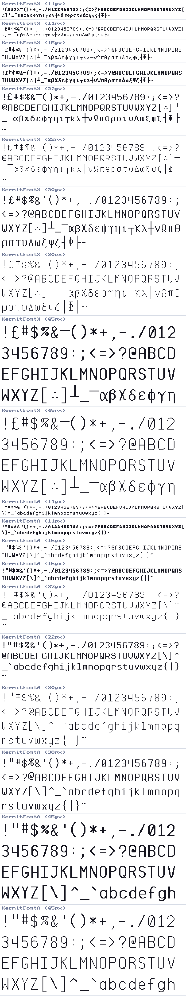

# Mac Kermit (KermitFontA / KermitFontX)



| | |
|---|---|
| Platform | Macintosh, 1994 (app) |
| Author | Kermit Project, Columbia University |
| Licence | **BSD-3-Clause** (see [LICENSE](LICENSE)) |
| Confidence | Medium |
| Source | kermit.columbia.edu archive, `ckc190.zip/ckmfon.hqx` ([archive copy](https://discmaster.textfiles.com/browse/17903/kermit.columbia.edu.tar/kermit.columbia.edu/archives/ckc190.zip)) |

**Why it is here.** Columbia states that "all other software in the Kermit archive to which Columbia University holds the copyright should be considered to have the Revised 3-Clause BSD License" (https://www.kermitproject.org/licensing.html).

**Notes**

- Medium: the 1992 file headers still say "not sold for profit"; the 2011 statement supersedes them, but only for parts Columbia owns.

**Converted files**

- These are **not period files**: the software never shipped a Windows `.FON` or `.FNT`. They were made for this repo from `original/`.
- Glyph shapes are unchanged. Any kerning is dropped, and empty code positions show a substitute character.
- The names "KermitFontA" and "KermitFontX" are original. The copyright text in the font header was filled in here too.
- Characters keep their Mac code positions, so accented letters will not match Windows-1252. Marked with the Windows symbol character set.
- One glyph with a left overhang was shifted and 8 were given a wider cell.

**Original files.** The `.bin` files are the bare contents of the Mac `FONT`/`NFNT` resources, extracted unchanged but without the resource file or `FOND` around them. The file names are ours.

## Original files (SHA-256)

```
b2212bb1037138aa483a286797ac7e2cd6f044f648a08fcb818647b42665412c  KERMITX-9B.NFNT-1024.bin
dfe8fa91452510ab7e333689fb8ea2f3b4745c9587650bf6f3b8e2f91b6041ab  KERMITX-9.NFNT-1028.bin
024e7638532e921dbbf025857a201958c6ef07bcd875d253b38103667fd345c7  KERMITX-12.NFNT-1029.bin
7fcb3dfe2991f1c244928c2338d8f13ca312f285e980a07a4af2f62978158ed5  KERMITX-12B.NFNT-1037.bin
a226da9ce6848b25bea52127bcda49de5ec14d7c2bc1f0cd45c78fef243f8c6c  KERMITX-18B.NFNT-1038.bin
878e7013a1506682f467de8fe0af700a4dad829a0acd4432d31f1df4780607f9  KERMITX-18.NFNT-1030.bin
dc574b9b3945b0ffdebdef4d5de99bb60d7e318c07297e6af1bd8560f76cd970  KERMITX-24B.NFNT-1040.bin
cb4365611ba502e63cb8bfaf39a091542a91c933a6971e7b31c0bf433712f693  KERMITX-24.NFNT-1039.bin
ecaaa60bbe4216de15873c49cd77c3e0ad7971e863b9211a41be01f56ed8f96e  KERMITX-36B.NFNT-1042.bin
99947ef4e4f3ef385681dc7d84f2a4d80c2941cd80e2b60a6f55d8b2c76a66c0  KERMITX-36.NFNT-1041.bin
d0ec36fb74129bbc54282e1bd1d6940ffe76174287604192cb940693df68fbcc  KERMITA-9.NFNT-1036.bin
d63a0ad34726c8744476a1ca3d14c33d0e912351914976f3e1a9578165a20c4d  KERMITA-9B.NFNT-1032.bin
bfa99216575ec6e269e469092ae399e4ea5c2df62ed31dd7b0b9ec61c0107aa2  KERMITA-12.NFNT-1025.bin
281f6ce38fdc00a5fe24b4a4b918e955281099a9ea5b317465123cbb2fc334c9  KERMITA-12B.NFNT-1033.bin
4b4255bbf1cb9d46c200d7fa0810763d5352a176ad3bc6695f2e0667bdd914a4  KERMITA-18.NFNT-1026.bin
f5244a4d2e0184dcd6b34117a1a3da5becf367f9a4c52075d1ebc71e5215fbf1  KERMITA-18B.NFNT-1034.bin
c3eb035f30565d5ebebc641a68fff1a261dfee501131591ed53a71e55700eeb3  KERMITA-24.NFNT-1027.bin
5a8963e37eb9c72e9872bf2da1d62068030402ee0c727520e0cfc7ec0800c340  KERMITA-24B.NFNT-1035.bin
10c63dbaaf5a7b889119f8274376b13092e6112676b12cfdefb480bb62a1a6ed  KERMITA-36B.NFNT-1031.bin
4e110a6be2abd49f64d50d92bfc076d737e51c25e5e2b65d0cc60225cecd93fb  KERMITA-36.FONT-14372.bin
```
