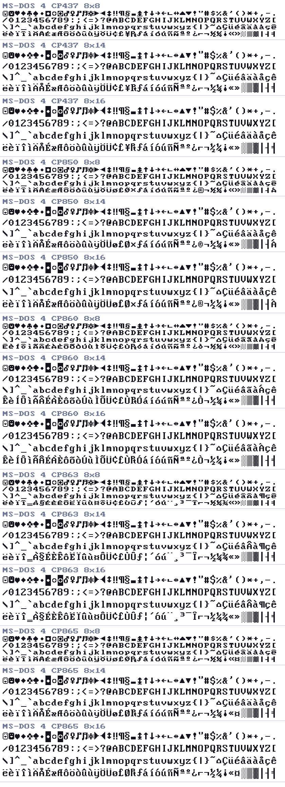

# MS-DOS 4.00 EGA/VGA display fonts



| | |
|---|---|
| Platform | DOS, 1988 (app) |
| Author | Microsoft / IBM |
| Licence | **MIT** (see [LICENSE](LICENSE)) |
| Confidence | High |
| Source | https://github.com/microsoft/MS-DOS (`v4.0/src/DEV/DISPLAY/EGA/`) |

**Why it is here.** Microsoft (with IBM) released the MS-DOS 4.00 source under MIT. These are the glyph tables behind `EGA.CPI`.

**Notes**

- `CPnnn_nn.FNT` is the same data as raw 256-glyph bitmaps, the usual DOS font-loader format.

**Converted files**

- These are **not period files**: the software never shipped a Windows `.FON` or `.FNT`. They were made for this repo from `original/`.
- Glyph shapes are unchanged. Any kerning is dropped, and empty code positions show a substitute character.
- The names "MS-DOS 4 CPnnn" were made up for this repo. The copyright text in the font header was filled in here too.
- All faces are marked with the Windows OEM character set.

**Original files.** The `.ASM` files are Microsoft's, unchanged. The `CPnnn_nn.FNT` files were generated from them for this repo.

## Original files (SHA-256)

```
9ba690ac66ea37c6afb257a7416fef29a5cf8184936150526de0ad081739f5d7  437-8X8.ASM
b8c58a575869ca4f1e8faf94cdd55781f89bdc1db64575d6ef38c4575bb04f0f  CP437_8.FNT
fb8086153e22431de9b63b66b6c2d7fbe100928d1ecb983c5d7d24315ff22109  437-8X14.ASM
bbf472b9fb815fa7f2612f024f75f26bca43b9c55fbf6610d4ceb6f3992727c5  CP437_14.FNT
9f4131f7df15b68e63689d8f062145ee275c47a7faf8209f29105fbf197f7787  437-8X16.ASM
ff3640ffffdd774ec56ee7ecacf7bce8324a67071155ade07f4c6380fa879025  CP437_16.FNT
966f874d5a3bffc4b348e4f691fec0386a28f5188c1df8aa88e51c651c1970ae  850-8X8.ASM
8769bbaccd9b33d7222bc061cc421cfe60b87933d3afc5df63949c1eb88877c5  CP850_8.FNT
78d914919514c35d94ef56dff3d9a63ad1ec9c71f59cf2b8d465f1fadec73527  850-8X14.ASM
d86fd04a9a11aaadc37f14ab222fe3890a9711c2ce1ff5ba5db230a1142407b3  CP850_14.FNT
2d1f1f4a015b757a73b506147215727c261af0474454d8913b2a85545c9282e7  850-8X16.ASM
1ed94fd927fbb74c00f09e72e77904dd5363b80a6005186a5545b22376427147  CP850_16.FNT
063da99c7cccc1fe58893effb7fb9be3db247e3491d223bfae8cadd654c01f00  860-8X8.ASM
2001710dea815099e74e9b5a5363f7b5365d2ed7ebacf4adb3636d4f31fba7da  CP860_8.FNT
7d85c8c2aeee17f544d6643b4e1502e81b7166dcb5085d2d91fe15b8eca04502  860-8X14.ASM
f0bd80a8d235136efdd5daf0ead9afbfb7ffe20540ed6ae7c210cef441787891  CP860_14.FNT
775671770fa104c1e8ccc213ac3b89470751f0b304cea5b0e74eedf43de5010a  860-8X16.ASM
0f48693e4164f83fe2036dea3bfa9066246c29b81796b8a34391c7e475e21b99  CP860_16.FNT
f6da43481d7d9b9bef8f674b0e8199cae492f3aee8909411544fa31083e04bc2  863-8X8.ASM
aca61a691e90e67b468429353d039ef70a143bfad43cf11639c17fde677d1c44  CP863_8.FNT
9bbc10f67818e2f3ef48d7ae3cb7b795f30ad7096c612cc466f5417c8541e1aa  863-8X14.ASM
7cc1ff3ef7f2465fee04a684374bd9f27531799e5f0ba818f7baec8669e9d813  CP863_14.FNT
47665421c04b45c1a414f6f3a97698c4e7b1a8ab61c627bdd2bd2ba7813731c5  863-8X16.ASM
4eaf932bf4eab8c6a0e4250e58fde5f9da4a42bbd47b26dcf6d08b3889b0f5d6  CP863_16.FNT
1ea94c58f6d4433269855745923b804092b0cac30a4d1b0322433680d91bdeaf  865-8X8.ASM
8a600feba64fcac2f954a29c4f255dba750fed1d46a9825ae89b286d87c055ce  CP865_8.FNT
5d060e1b0beadd4563b69c68244169c93e7795f1586d8b438b865b2dfa6ea20f  865-8X14.ASM
b381c525f4ac4cbbc821831bb205d06912033f80f0883803d98e05d7c7b00b1d  CP865_14.FNT
f9ab6ca88dd2436ffaac903b228f34b5d810d512c8f0adb4f8f4ecbd01e82ca8  865-8X16.ASM
840c4792b048b0bffad4b9b130dbefb3f2fa48ef1aa142deb882f01fadcd8eda  CP865_16.FNT
```
