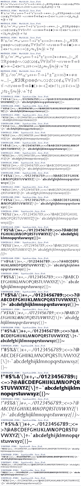

# Oberon System for Windows (Syntax, Math)



| | |
|---|---|
| Platform | Windows 3.1, 1993 (app) |
| Author | ETH Zürich; fonts drawn by Hans Eduard Meier |
| Licence | **BSD-3-Clause (ETH)** (see [LICENSE](LICENSE)) |
| Confidence | Medium |
| Source | Oberon/V4 for Windows, 1993 |

**Why it is here.** ETH licensed ETH Oberon, "Copyright (c) 1990-2003", under this BSD-style text. Its documentation names Syntax and Math as fonts delivered with the system (https://en.wikibooks.org/wiki/Oberon/ETH_Oberon/font).

**Notes**

- Medium: the licence text was published for the ETH Oberon (System 3) line; this copy is from the V4 line by the same institute. A 1995 V4 readme still forbade commercial distribution.
- "Syntax" is also a Linotype typeface name; treat the name as a possible trademark.

## Original files (SHA-256)

```
9787ae6b3331f40c9c392dbc769851de4d3cdede94490f598c4ede0aba6db265  MATH10.FON
646b40ec6c0cd8c546e79f4656e5224322cb673e2f660a72dbf2ac6d12c923f7  MATH12.FON
cc51e42d2a2b295069e6dc23c0d0ad25fdc37524df48d4294661d2658241b1b2  MATH14.FON
1dd5ae86bb9710f38d2f3a50424cbcf65d8630dd33837f72e74feb06b2579625  MATH16.FON
6886a58444f5de1bb8766bdc4c71b96a79cb5c8b448bfb4c9ab1d89a75689cf1  MATH20.FON
d17b8dec310033eedbcc6d90c5aeb874058f897064c3e576e069e5a346a7de41  MATH24.FON
4433772c04e813985c5c2db2da5b64eb5556b2ebe7833c837edf9f20df18db9f  SSYNTA12.FON
5de5691837b7b2ada5d54cbb89c51b0c233dc4dbad7339a456c437669465768a  SYNTA10B.FON
f34705d03293df38c29cddd5473c7cf83e58fc5ade5a93b34ca6b12576a508e8  SYNTA10I.FON
6ad7d58546e9e77e8ce145b1566b2a0b791fb486591f512e62513b5188d7eda4  SYNTA10M.FON
822fd68b451ea1e32f1f732a74ac398d54850096af746c2a9e9ab74befe5c11c  SYNTA12.FON
64145c006126a389d2cffaa9bf0738c53908000ed17f745b310fb9f9af2d1e77  SYNTA12B.FON
4407840c88fb4794ba5f6fd85ca63a24a06ec9196721def2e74fc9d0c9cf0857  SYNTA12I.FON
1b88eec3f5f7dbbea0554c2c8698bc5f9b3b8d23635a06d0160305e447c7e5c7  SYNTA14.FON
e4d1c0817256ab82d32ca45af1364be509aebf19975d551bbb0fc3876776c1eb  SYNTA14B.FON
95a76e9040d99407cc74313527b3942bea52bffd40fd75656eb328aa6d7a7836  SYNTA14I.FON
3faeb39177adf6356c3b0e733d31a2ca73accc805327920ad48f44d4070e34c8  SYNTA14M.FON
5f752d6dc32fa40a4b1e6694d7ca7d40e3fb7f9294fe3db0fe471c69bd85692d  SYNTA16.FON
807ff8b46b62098d4a400a3991bfc8783821a9791fbbe96dface561d56fbfa42  SYNTA16B.FON
6fd9563d2c81e2571196e51449947853c7b0d806bd61a3e3c937d23f9cb3e14c  SYNTA16I.FON
0e0d938398e21e7916e7b6b975022aa61ae96e9c34e8dff0e35a31c88f8b8cfc  SYNTA16M.FON
124a9952e670f03f82f72511eec3a5df367d04825eb9db9fe7648363332fecd8  SYNTA20.FON
19c172f614ee650ba2a2dcfc50316b26d2fce55edc459c940ae3264e1b8f23fd  SYNTA20B.FON
f27f05488bdb19d38ce4523bad77851d1ddb808fb1c3619c0001d0d0b564789b  SYNTA20I.FON
98e5b28154e6017d80637aab23015bba51e9c44737240456e84d69929ee9416f  SYNTA20M.FON
7712f6833f7002297dbcb607417e06aa8b43b883e46ea164fee670ab94932ed9  SYNTA24.FON
f9e3e8a5321d99e0c7bc5f3122f9745cb640c148194a32c761c195671f0a17bb  SYNTA24B.FON
09ca5b946127f21f8669a79ba59bde5dc44355dcd4826c00d7aeb85555570b4a  SYNTA24I.FON
360efc5cd15c33b7e92a1f4c956890480f63751c679c0f5d483f49b684fa3a72  SYNTA24M.FON
90547431d87a62952db74c1056c989db557d0ae3991c45d95635779b17dfea88  SYNTA8.FON
8c2d63c7788ae15d370f6ded371309fca1c4165e8ca7af6c5925e0a1b3bceb9e  SYNTA8B.FON
731201bb282c24c0899e3b9668eabf92ac77e13873a1c1911209c7e791efd2b7  SYNTA8I.FON
7a09b81f427dfe317ffb570bcb72a63de9f89315038d33b8d7a13c99a6c31ada  SYNTA8M.FON
3a27e8f3ff0acc24d862d8d5efc705816712785ac68bda93e0c58b06fa98a2a9  SYNTA10.FON
```
