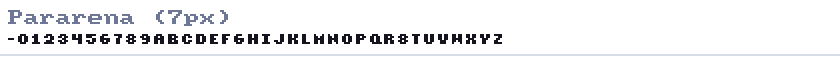

# Pararena 2



| | |
|---|---|
| Platform | Macintosh, 1992 (game) |
| Author | John Calhoun (softdorothy) |
| Licence | **MIT** (see [LICENSE](LICENSE)) |
| Confidence | High |
| Source | https://github.com/softdorothy/Pararena2 (`Pararena.project.r`) |

**Why it is here.** The author published the game and its resources under MIT.

**Notes**

- Capitals, digits and a few symbols only (41 glyphs).

**Converted files**

- These are **not period files**: the software never shipped a Windows `.FON` or `.FNT`. They were made for this repo from `original/`.
- Glyph shapes are unchanged. Any kerning is dropped, and empty code positions show a substitute character.
- The name "Pararena" was made up for this repo; the original is unnamed. The copyright text in the font header was filled in here too.

**Original files.** The `.bin` files are the bare contents of the Mac `FONT`/`NFNT` resources, extracted unchanged but without the resource file or `FOND` around them. The file names are ours.

## Original files (SHA-256)

```
2922433b6599c4ad6ef69a886ee932ee003f5924be5def792915bf1732fdb2b1  PARARENA.FONT-25863.bin
```
