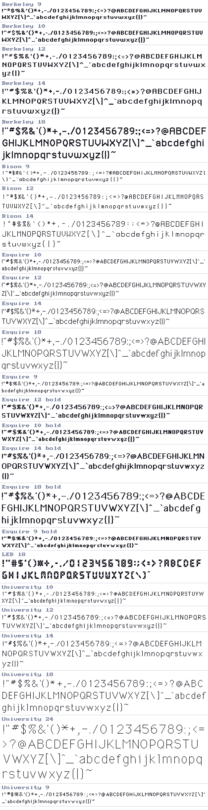

# PC/GEOS (GeoWorks Ensemble)



| | |
|---|---|
| Platform | DOS, 1990 (app) |
| Author | GeoWorks / Breadbox / blueway.Softworks |
| Licence | **Apache-2.0** (see [LICENSE](LICENSE)) |
| Confidence | High |
| Source | https://github.com/bluewaysw/pcgeos (`FontData/`) |

**Why it is here.** The current owner of PC/GEOS published the source tree, including `FontData/`, under Apache-2.0.

**Notes**

- Originals are GEOS `BSWF` fonts, not Windows `.FNT`; use the converted copies on Windows.
- Only GEOS' own bitmap designs are taken. The outline fonts in the same folder (URW Roman, Sans, Mono, Symbol) are left out.

**Converted files**

- These are **not period files**: the software never shipped a Windows `.FON` or `.FNT`. They were made for this repo from `original/`.
- Glyph shapes are unchanged. Any kerning is dropped, and empty code positions show a substitute character.
- The typeface names are original. The copyright text in the font header was filled in here too.
- Accented letters were moved from the GEOS character set (read here as Mac OS Roman) to Windows-1252 positions. Characters with no Windows-1252 position were dropped, 0 to 25 per face: `≠` `∞` `≤` `≥` `∂` `∑` `∏` `π` `∫` `Ω` `√` `≈` `∆` `◊` `⁄` `fi` `fl` `0xF0 (logo)` `ı` `˘` `˙` `˚` `˝` `˛` `ˇ`
- Bison 13, which contains a single character, was not converted.

## Original files (SHA-256)

```
5e06a6774f2a9fb7400e8f22a857b8a4a411ce0b638d82ef24deda15360fe2ac  Berkeley.fnt
90d08aa4fe62bf4fb413fcff0e6b467561b2410818ab321838c016b1f3ea3f25  Bison.fnt
bd00580f4b089aa3646f667f3f5294e47b70b47d29b431157e19e8760cc75b5f  Esquire.fnt
7af1561fbd88bc8c98935c2b5348853ac586809355fd3daf49e0626e96bbf0ca  LED.fnt
862bf7ef3946863e1743ea147edaa666d5515cac7b2e663308d74a755913408c  Universi.fnt
```
