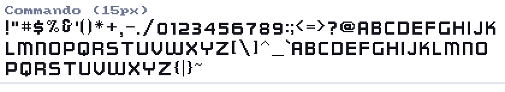

# The Colony ("Commando" 12)



| | |
|---|---|
| Platform | Macintosh, 1988 (game) |
| Author | David A. Smith / Mindscape |
| Licence | **Apache-2.0** (see [LICENSE](LICENSE)) |
| Confidence | Medium |
| Source | https://github.com/Croquetx/thecolony (`Extras/Colony.dsk`, FOND 190) |

**Why it is here.** The designer released the game and its original disk images under Apache-2.0. The font is inside that disk image.

**Notes**

- Medium rather than High: the README only says "this code", and nobody has stated who drew Commando.
- The PC version's `SYSTEM*.FNT` files are **not** included; they belong to MetaGraphics' MetaWINDOW library.
- The disk image also contains HyperCard (Apple) and a Zapf Dingbats resource; neither is included.

**Converted files**

- These are **not period files**: the software never shipped a Windows `.FON` or `.FNT`. They were made for this repo from `original/`.
- Glyph shapes are unchanged. Any kerning is dropped, and empty code positions show a substitute character.
- The name "Commando" is original. The copyright text in the font header was filled in here too.
- Accented letters were moved from Mac OS Roman to Windows-1252 positions. 18 Mac characters with no Windows-1252 position were dropped: `≠` `∞` `≤` `≥` `∂` `∑` `∏` `π` `∫` `Ω` `√` `≈` `∆` `◊` `⁄` `fi` `fl` `ı`

**Original files.** The `.bin` files are the bare contents of the Mac `FONT`/`NFNT` resources, extracted unchanged but without the resource file or `FOND` around them. The file names are ours.

## Original files (SHA-256)

```
6cd72efdf33104dbe28816f4cd247009522cef2e1a2a9e8f8cdc9832ee1f316e  COMMANDO.FONT-24332.bin
```
