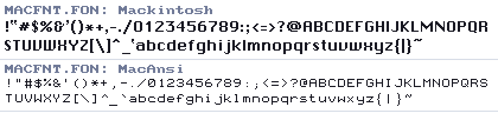

# Finder for Windows 2 ("Macky Hacky")



| | |
|---|---|
| Platform | Windows 2, 1988 (app) |
| Author | "Macky Hacky" (pseudonym) |
| Licence | **None; author deliberately anonymous, free distribution invited** (see [FINDER.TXT](FINDER.TXT)) |
| Confidence | Low-Medium |
| Source | `finder.zip`, via the SUPTEL Pro BBS, Paris |

**Why it is here.** The font says "(c) Copyright Macky Hacky 1988. All rights reserved." FINDER.TXT says everyone is invited to distribute it "de manière aussi large possible et ce gratuitement", and that the author wishes to stay anonymous.

**Notes**

- Free-of-charge distribution is invited; nothing grants modification or sale.
- The faces imitate Apple's Chicago and Monaco but are not straight copies: 19 of 76 glyphs match a Chicago-derived 12-point bitmap, and 9 of 94 match Monaco 9. Apple could still object to the resemblance.

## Original files (SHA-256)

```
2684aa369890663dce7d9c0b6dc98f7fab7be399cd6ea483465d6f46bb4717db  MACFNT.FON
```
