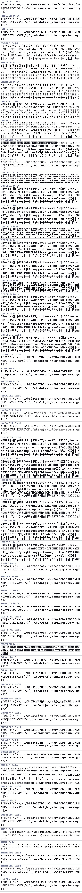

# fntcol15: anonymous EGA/VGA text fonts



| | |
|---|---|
| Platform | DOS, before 1993 (app) |
| Author | Unknown (collected by Joseph Gil) |
| Licence | **Unknown authors; compiler permits any redistribution with notice** (see [COPYLEFT.TXT](COPYLEFT.TXT)) |
| Confidence | Medium |
| Source | `fntcol15.zip` ([archive copy](https://discmaster.textfiles.com/browse/17903/kermit.columbia.edu.tar/kermit.columbia.edu/archives/pcfonts.tar.gz/pcfonts.tar/fntcol15.zip)) |

**Why it is here.** The compiler's notice: "Permission is granted to use and redistribute the files comprising this collection in any way (including conversion to another format), provided that my name and addresses and this notice is preserved … Individual fonts are in the public domain." Despite its file name, COPYLEFT.TXT has no share-alike clause.

**Notes**

- The public-domain claim is the compiler's opinion; the original authors are unknown, which is why these sit under `orphaned`.
- Only fonts whose designer is **not** named in FONTORIG.TXT are included. Left out: shareware (Greek, TeX-math, Persian, Esperanto, thinasci, runic…), Hercules card fonts, Rimrock, Intext, AST/MS-DOS code pages, VGA ROM copies and the Macintosh look-alikes.
- Some extend the stock DOS font: in the `.F16` versions of HEBYOGI, CYRILL1-3, BINARYED, HEBUGLY, MODERN and SANSERIF, 45 or more of the 94 ASCII glyphs are identical to the MIT-licensed MS-DOS 4 8x16 font.
- Raw bitmaps: 256 glyphs, one byte per row. The extension is the height.

**Converted files**

- These are **not period files**: the software never shipped a Windows `.FON` or `.FNT`. They were made for this repo from `original/`.
- Glyph shapes are unchanged. Any kerning is dropped, and empty code positions show a substitute character.
- The face names were taken from the file names. The copyright text in the font header was filled in here too.
- Marked with the Windows OEM character set, whatever the alphabet of the font.

## Original files (SHA-256)

```
9744de2ffe18766f4c0fe83db3673a700a038f38c8148f1da037e4f9c2879a0b  2_HEBREW.F16
b7ffa71319ed7b474197462de44fa6079e4aed7185fe29c13bc0ba5db9dde5d7  ANTIQUE.F14
7bb5b58383212d9ac3a4eefb9260e585fc0981ceb5dc1d8fd0c7dfef269f12b8  ART.F16
2ca67b6beecedb6ceba7e081a62d2fdfa008a2f9efe9dd1f691153030ec6b166  BDECLO.F14
df87c67fc721c035e11a227392f82fdbc32eba4d3296b0f901b442454e178f36  BHEXALL.F14
9e23cf1f418887cd21de4e7d1f1bc37d3c65d4bb4f47c530d91b2d32365cfb30  BHEXBOX.F14
35ebb03c0a467885cf8d2ced200f78e8138407938a10c8b550a37503daa93c43  BHEXHI.F14
941224bd7f110b2b22137488b6385881031494612d5459b3c1ce3ca2622a1a24  BHEXLO.F14
0f747944f028450587119d4e7928addb1b8b38dd58f4280c378396d7f39d6cc5  BINARYED.F14
8296ceb6be4f1b13f1d49004e56e411dcfc2a5aee8422e1a211ebf5404856ab7  BTHIN.F14
8d3daacac51b10dbb9924be6fd354c411325517817b38aca5734f722a88980eb  CYRILL1.F08
51a6a63d3a8324dc98228c89d290706a30ef180dca0f282c7c4cc4f54103fb4e  CYRILL1.F14
bc5c9e9341a56235507dc8eb07741ec9ca50d606ab5c1115412f43f151290c6f  CYRILL1.F16
e5b9681a12f03e4044c4fc0d9cef7fd3cc2f640631c84c698bf6d7c4b5ee3886  CYRILL2.F08
903ed6c1bd21aaa3e4433cd5da7a36a8d3f9fe0e4d02629ef524699c002c8335  CYRILL2.F14
3837be5f9a7a7c5a9b709bf427ae6b82209ecb1fe3a8d0afcc85d59783ded869  CYRILL2.F16
23350365d587d3eb54ec0e3af15166380d082cfa3cd23bab9e342fa47d8cfaa3  CYRILL3.F08
6e93ff1237cc9262679470e7caaae588da3d3242999531b9caefabefae0959e1  CYRILL3.F14
f5165c43fbab70124da2c0a00f094303d70194393b2c6710a18fb4298aabb4c7  CYRILL3.F16
560270ab8d91252b267679947779ef27cc63526cfb10e2a14785d6129c354a19  CYRILLIC.F14
b7ec6839cd1e5b433cf6bed9248b5de54a8aad06a62e56bcb57ac638c28eef6e  DECORATE.F16
7cb83caae5dabb4a3297989c2117dde36407952fdd0a2226f4a328d1602c0459  FINNISH.F14
7d9614966d7e82a7dd84203969de0c8db6c711a6a7bbc06b3e40bf5a6bf86121  HACK4TH.F16
97892e41490490d8a046bdd4fc639e030f1fc23e43d5650429c8d42e40f601b0  HANDUGLY.F16
2e7b152c2a1648260232fcca88cf8cd0655d811b9ca922311b7c463a91bea727  HANDWRIT.F14
9b654f4bb9d920a43ad295fe9ed5bada46a0b181daf1015cccbda3311b5d6989  HANDWRIT.F16
f2c2c667fdb1b13210942fdd28ba71e98c9687a29c2df18dfe617a009a46b26c  HEB-7BIT.F16
65162e7b87c2215a660d09cc902ffb68a582e641647f2907916da490ae0e3ed3  HEB-BOLD.F16
8440a6b90287c9359bc64d1b7328f5652c6a2079ab77fc724cc7b4a55f26b13a  HEBCLRGF.F14
03d7d64cb1db8cd4780f24c55c37ba60e10d314e4a6210feefb3a990e0cb8fcf  HEBCLRGF.F16
4e75a57893ff573a4e41bee753f294feef3c9ee95f378a49bdc380937d49ba38  HEBUGLY.F16
0e235fd152516f90e9eebbca1d4869757ed4cfb13db8381d3980f90352dc5caf  HEBYOGI.F16
3220c012fa5ca1567481a914ef8a40d2ca8874d8e7c491558f069c2ff47b67d4  HYLAS.F14
894d38c980ece31c4563e0fd092fd84426c5b31b0407ce8006952ee100d6536f  MODERN.F16
96c2bc3febeb452ef9cd9b09df31d90622279b9f99f954c20c81a58b9a4422bb  NORWAY.F14
23ca3df5b897f85683af1f906f3beb0a0714ca383bcec0f1ce00139f955e30fc  NORWAY2.F14
598a28f76567914c6530cba51a4d3ac43036ba19257ccd6294c1ee33f870c2f4  OLD-ENGL.F14
029108b787f20ff6cc124697a9561f888fd81ae36f329dc55df35a3cc45a6a42  OLD-ENGL.F16
8ce7e00003751248cb1a060dac8db9a655b3c8aa410c998fc77492d1b941a2a8  REVERSE.F14
62218834ad1242e5348a84c97c9e111a24c38bb72b65b690e20384f984d64e1a  ROMAN.F14
c9de153f813b5a8039786d46fcfee502762b745fc6c8e6c6805dba4684f55d5e  ROMAN.F16
f950f1bfcd951045766a40cb0dbcf320eead75f078db78d6957727b88bb980fd  SANSERIF.F16
9f88fcf8bfcfa3b4378de3262aa31737a4b6ac853ea870893f835644fba35223  SCRWL---.F16
6ae90946b542fb34458f00879850aa1adf4b1cce390cb049c8360910f24ade2c  SCRWL~~~.F16
3858359bcc9feacd3f8d660f4cd6d997239c338c754338a92b3561ccb70ceafc  SMALCAPS.F14
0489a3cd4165a87127c9376b6db829aebf824fab560d483b1229f8504ac9e8c3  SQUARE.F12
d0fd4129c1061cea49da1a028e7fca4230c755fb9e88d5fa97924af2284af3ee  STRETCH.F14
c4138dfd66e16407af77dfd8f396705f9ac47b8e35fec3ae41ed885b7668e099  SUBSUP.F16
4f8026880658a65e5da92438d49807543acb56f73489bad0aede53718f9e9c62  SWISS-AV.F16
9d6a99c3cb9ec8fda3126412dd9bf3522e9e70b5a04fe856b819e85cd03a448c  SWISS.F16
066b8ffdf9b783ca1383f62a680b817e80d39a567457413b9babce43974e38f6  SWISSBOX.F16
13133563f3953990bf8ec636c62ad9ea089adaf9fcb90fcf15d4408ff59b9727  THAI.F14
4722ff38f315a5bb36654d3f067e07a44f84b5d9f62c5f07102a0b3dd637fd08  THIN.F10
0b64db7eb6ac82319274fa04b3e6a4fce52d7f0f540cf2627ade52b94923d34a  THINCAPS.F14
38587e29464470759a81b55a1a969352f9edd72b05707fbfee0e00f94bd06513  THINSCRP.F14
0c6043987b22ddf682f9d08b060929d79ee0f122d4f3d1f3f9c67b8b5d8581f8  WIGGLY.F16
```
