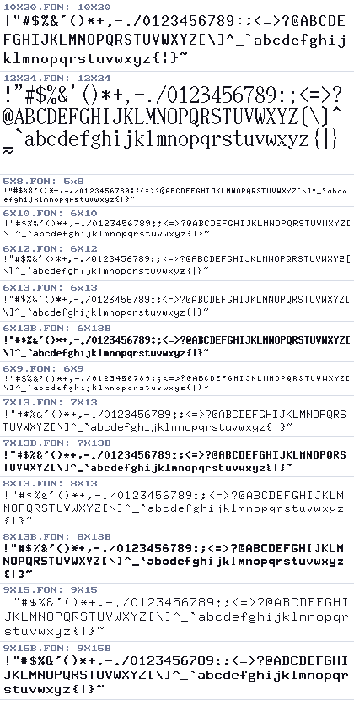

# Angband 2.8.1 (X11 "misc" fonts as .FON)



| | |
|---|---|
| Platform | Windows 95, 1997 (game) |
| Author | X Consortium contributors; converted for Angband |
| Licence | **Public domain; X11/HPND for four files** (see [X11-FONT-COPYING.txt](X11-FONT-COPYING.txt)) |
| Confidence | High (10 files), Medium (4 files) |
| Source | Angband 2.8.1 for Windows |

**Why it is here.** Ten files carry "Public domain font. Share and enjoy." in their own headers.

**Notes**

- `12X24` (Copyright Sony) is covered by the Sony permission notice in `X11-FONT-COPYING.txt` (font-sony-misc).
- `5X8` (Cognition), `6X9` (MIT) and `10X20` (Network Computing Devices) carry old copyright strings, but X.Org ships the same fonts in font-misc-misc, whose COPYING says "Public domain font. Share and enjoy." Medium confidence.
- The Angband game code has its own licence; only the fonts are here.

## Original files (SHA-256)

```
4a91394af533a548dc48cc66daee4046c7dac4776a21126d93c8823b3376fac7  10X20.FON
6cebc8b0906f8be1e1b73c44e4cb5999b1122407a811b4a331a2183998f7f58e  12X24.FON
542e5fda304e5a34d88667bbc63e1c39de6b8df135bde762a9ba7f9619d0a3d1  5X8.FON
e657119cca03130bbff8a238e59554458aeb2f030c81fb5d57fedfe621ebc135  6X10.FON
a724feb3afcd30ee493e9e0aab9f45c42fb7fd30feb30942a4c5d251388c2a19  6X12.FON
82e0ecdea9c92ef253c4d897ab7f2bb1eefc89d348e711309b3b5a736f9afd41  6X13.FON
31f1fddc38c7840c7f305fb19bc0cc093f3cb79fe16c59c5ba9d6c4bcf1d1177  6X13B.FON
76bb96b2720d63ebed813ca522ab07df8f22679574fa9660ca9513e056eadc6d  6X9.FON
606a0b216369a4054edab62d2ac83f561a05eef74af898307c32ba333ebad83a  7X13.FON
2c8c74645a5fa6609dbf986987f69f68463a0b9a3a0e27649bd0b38895d1c7fa  7X13B.FON
6d27d42c4c10e0d7ec524bd06eb0a04e9366fbeffb5bca0f3cac9199970c90f2  8X13.FON
9aaf076cb8271de93fd56ff071b6e27a7fa16d12cfd733cd9321cbbe6a4914d9  8X13B.FON
77546f4aa2c99e30b1e8f5957bef683ce58b6582c4f5f181914178d2f4982d86  9X15.FON
3ca0b4edc611a759865d7b1aaf23acfb721f31dfbcb364e890169b3f97332a19  9X15B.FON
```
