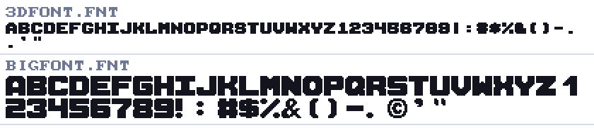

# CFONT 1.00 colour fonts



| | |
|---|---|
| Platform | DOS, 1995 (app) |
| Author | Nikolai Soumarokov |
| Licence | **Public domain (keep package whole)** |
| Confidence | Medium |
| Source | `cfont100.zip` |

**Why it is here.** CFONT.DOC: "This library is Public Domain", and of the sample fonts: "you can use them freely in your programs".

**Notes**

- The author asks that the package be passed on complete and unmodified, so the whole original package is here.
- 8-bit colour fonts (3-byte header: count, width, height). The preview shows shape only.

## Original files (SHA-256)

```
01b1b20ca8b625107c25d1dbaf4c2a55846e41b80553c4bf6ff8e43e48331818  3DFONT.FNT
126a0f9a36ec2f2beb11350111e59515888d6494435894f040f5ff69ea725d7d  BIGFONT.FNT
4a8730f10662173021a89ecdce4555dcdca0212ca5f434f78a2b883b38e7ff81  CFONT.DOC
7a791225e28d643de7d57641aa80fb7288e065b2478951451e7a8b17c9d073cd  CFONT.H
370c7718932d56915fb94aae272652b9b19e01a7aeee74badf0961aa637efebb  CFONT.LIB
b6dd34314102e429fdd98390b1fda27d3ea94d16bfcefa2983e3e319a2a20eae  DEFAULT.PAL
b68983a4dc90c8296da1cf15fb651bb43b6e9b4274c01647702220ea7e8e6c30  FONTDEMO.CPP
eac4e9f2d0b676407746b4fda1f6e010f1570479c968dda02762b1e038ae83ac  FONTDEMO.EXE
```
