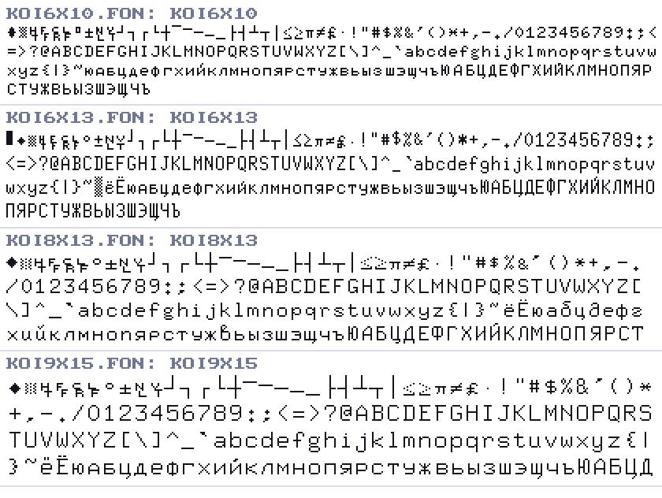

# KOI-8 Cyrillic fonts for Windows



| | |
|---|---|
| Platform | Windows 3.1, 1994 (app) |
| Author | X11 Cyrillic fonts, converter unknown |
| Licence | **Public domain** |
| Confidence | High |
| Source | `koi8fon.zip` |

**Why it is here.** Each file's copyright field reads "Public domain font. Share and enjoy."

**Notes**

- `KOINIL2.FON` from the same archive is left out; it has no notice.

## Original files (SHA-256)

```
04390aeb01a95d15bfbd6cb34040d651f145699db04613c618a04775d7642d1f  KOI6X10.FON
5e4eddf7098f28d4b4bb539d873aad3b1182d55c53930d460d741f863f271c93  KOI6X13.FON
c65dcb2eb36eaeb8b2e4aee19277ea54ce7f99ad462eebb5f44a5f23d52dbcdf  KOI8X13.FON
120bcfe08ac45f8cdec116f9bd13f35a0848efbea7a417735c25ea78d1308b81  KOI9X15.FON
```
