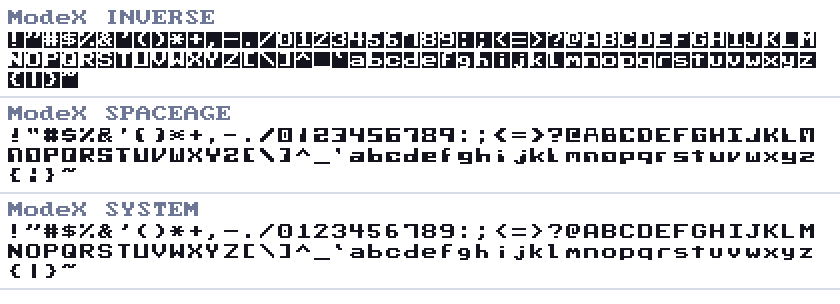

# Mode X Library 1.05 (font editor)



| | |
|---|---|
| Platform | DOS, 1993 (app) |
| Author | Matt Pritchard |
| Licence | **Public domain** (see [README.DOC](README.DOC)) |
| Confidence | High |
| Source | `modex105.zip` |

**Why it is here.** README.DOC: "The Mode X Library … The Font Editor and Palette Editor are also placed into the Public Domain by the Author".

**Notes**

- The README also asks for credit if the library is used commercially.
- `ROM_8X8.FNT` is left out; it is a copy of an IBM/VGA BIOS font. Use `open-source/ms-dos-4` instead.
- Raw format: 128 glyphs, 8 bytes each.

**Converted files**

- These are **not period files**: the software never shipped a Windows `.FON` or `.FNT`. They were made for this repo from `original/`.
- Glyph shapes are unchanged. Any kerning is dropped, and empty code positions show a substitute character.
- The names ("ModeX …") were made up from the file names. The copyright text in the font header was filled in here too.
- Marked with the Windows OEM character set.

## Original files (SHA-256)

```
954fbd12cd13c2f1ea3fe7c299d198fbfb4f173c97c60fac6dc650229c123294  INVERSE.FNT
c451573f3af84a0ac962748f49c5f8717e09f4463c22b697c59519f848d5a3bb  SPACEAGE.FNT
dd938c14f1c0847ebe5f1ce41b9933b3aa8c9e9479f9474f9a1bfa6d9db8a545  SYSTEM.FNT
```
