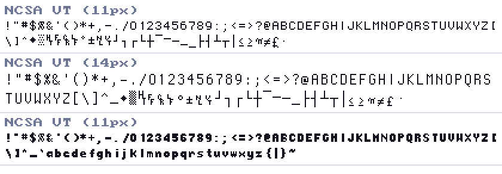

# NCSA Telnet 2.3 ("NCSA VT")



| | |
|---|---|
| Platform | Macintosh, 1989 (app) |
| Author | NCSA, University of Illinois (Tim Krauskopf, Gaige Paulsen) |
| Licence | **Public domain** (see [README-NCSA-Telnet-2.3.txt](README-NCSA-Telnet-2.3.txt)) |
| Confidence | High |
| Source | GRIPS 2 CD-ROM, `mac/ncsa/telnet_v23` ([archive copy](https://discmaster.textfiles.com/browse/13235/GRIPS_2.cdr/mac/ncsa/telnet_v23/mac)) |

**Why it is here.** The 2.3 release note: "The documentation, program and source code are in the public domain. Copy, modify, distribute and be happy."

**Notes**

- The app's Monaco (FOND 4) belongs to Apple and is not included.

**Converted files**

- These are **not period files**: the software never shipped a Windows `.FON` or `.FNT`. They were made for this repo from `original/`.
- Glyph shapes are unchanged. Any kerning is dropped, and empty code positions show a substitute character.
- The name "NCSA VT" is original. The copyright text in the font header was filled in here too.
- Characters keep their Mac code positions, so accented letters will not match Windows-1252. Marked with the Windows symbol character set.
- Three glyphs with a left overhang were shifted and one was given a wider cell.

**Original files.** The `.bin` files are the bare contents of the Mac `FONT`/`NFNT` resources, extracted unchanged but without the resource file or `FOND` around them. The file names are ours.

## Original files (SHA-256)

```
15e66da79017f7e222a9a5de8c470db54648ea91e2c2d78f9b648f2e2d7cf155  NCSAVT-9.FONT-9481.bin
6f97076abcbacfec0fa5b22a7175e5f296c661e19b8ea0f488c54147a2d5bc89  NCSAVT-12.FONT-9484.bin
ca55015a0d5b9d775bef7ca5554f010d532c50c019d3afdd9597a5f21b44413a  NCSAVT-9B.FONT-9609.bin
```
