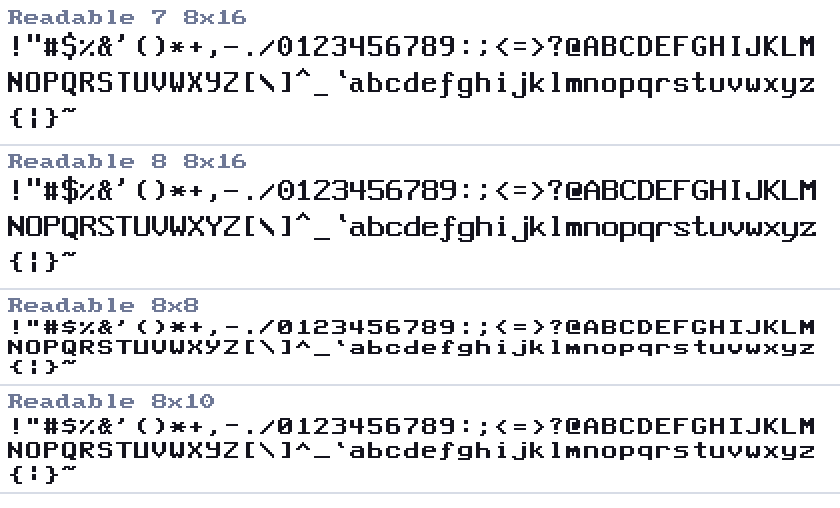

# READABLE text-mode fonts



| | |
|---|---|
| Platform | DOS, 1993 (app) |
| Author | Miguel Farah |
| Licence | **Public domain** (see [FONTORIG.TXT](FONTORIG.TXT)) |
| Confidence | High |
| Source | `fntcol15.zip` ([archive copy](https://discmaster.textfiles.com/browse/17903/kermit.columbia.edu.tar/kermit.columbia.edu/archives/pcfonts.tar.gz/pcfonts.tar/fntcol15.zip)) |

**Why it is here.** FONTORIG.TXT quotes the designer: "Since this is PD, there is no a warranty of any kind".

**Notes**

- Raw bitmaps: 256 glyphs, one byte per row.

**Converted files**

- These are **not period files**: the software never shipped a Windows `.FON` or `.FNT`. They were made for this repo from `original/`.
- Glyph shapes are unchanged. Any kerning is dropped, and empty code positions show a substitute character.
- The names ("Readable …") were made up from the file names. The copyright text in the font header was filled in here too.
- Marked with the Windows OEM character set.

## Original files (SHA-256)

```
0fbe68596a7f7b2edb61a4897eb2c3e168796b972c80bffac34fe5fe343cfe8e  READABL7.F16
2ffc2126776617b01326f88feac540be3b26862921089bb3d8470836e512eeeb  READABL8.F16
db4e397848c4cc5dede834fbeb3a00d2deca92bf6c129bf135effc702de87d19  READABLE.F08
c8299fad12ddf13c0f5c6e14ad88fb5759fd6cffec0f2d92703348abfe438f8e  READABLE.F10
```
